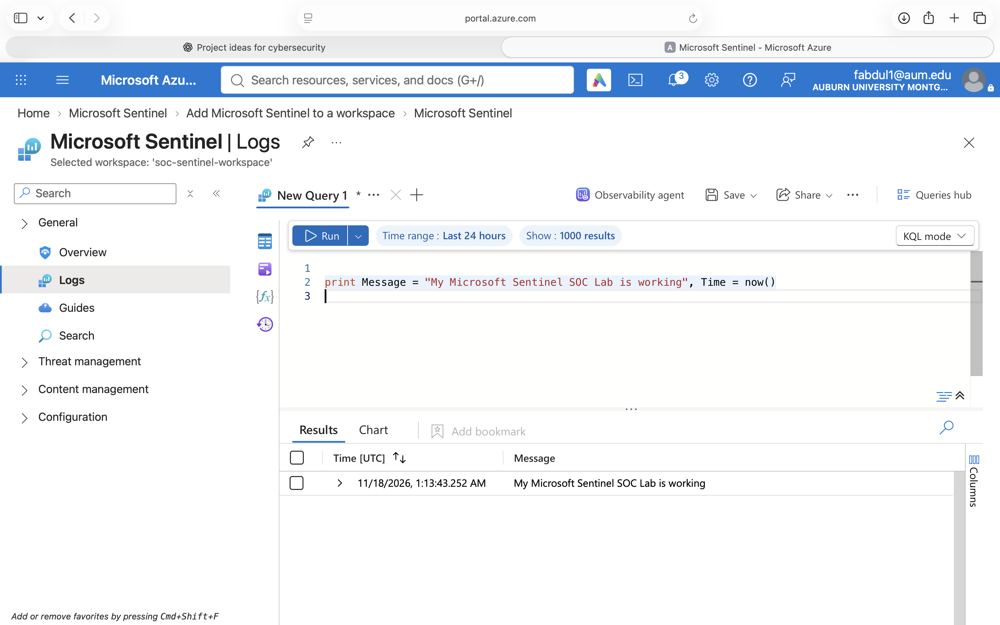
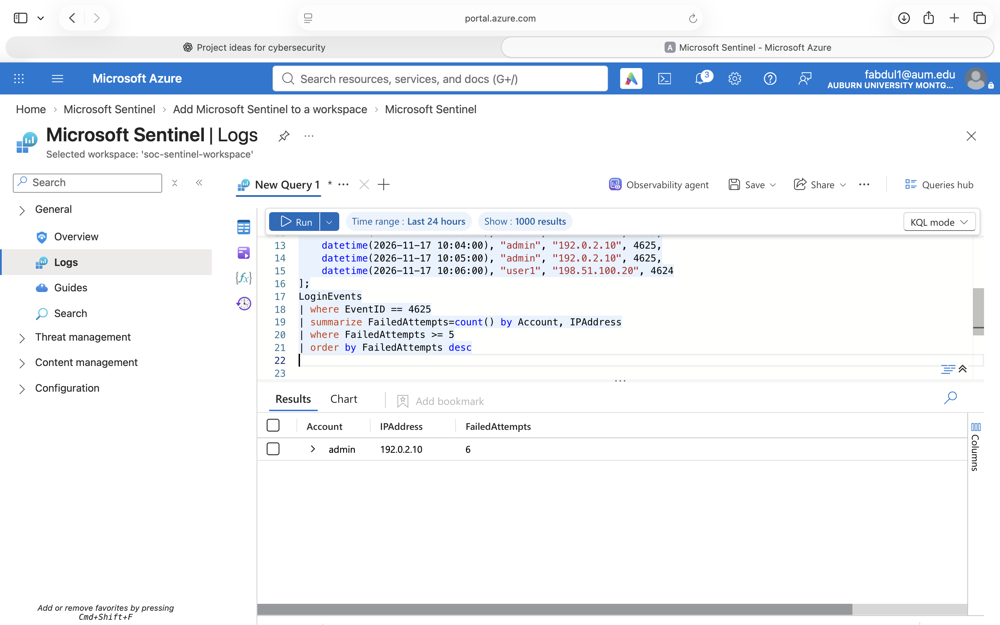
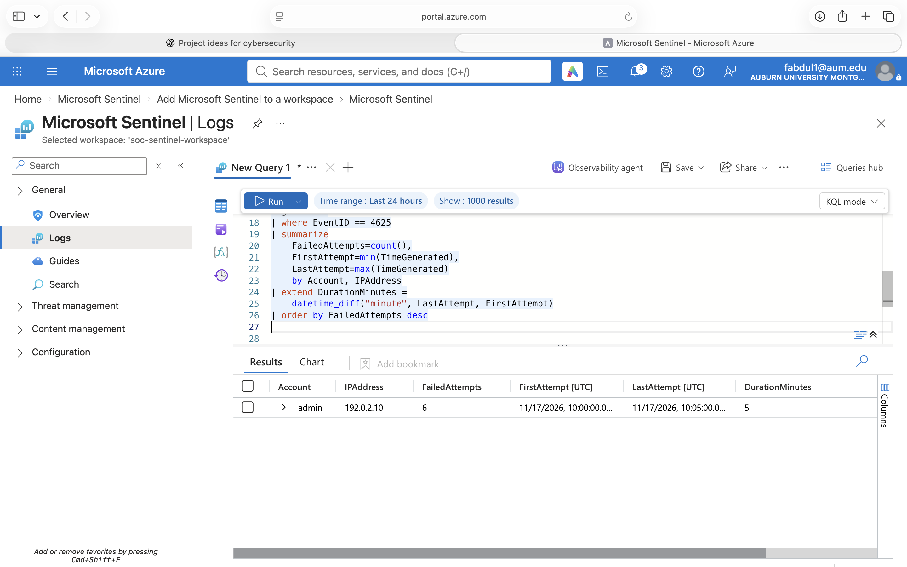
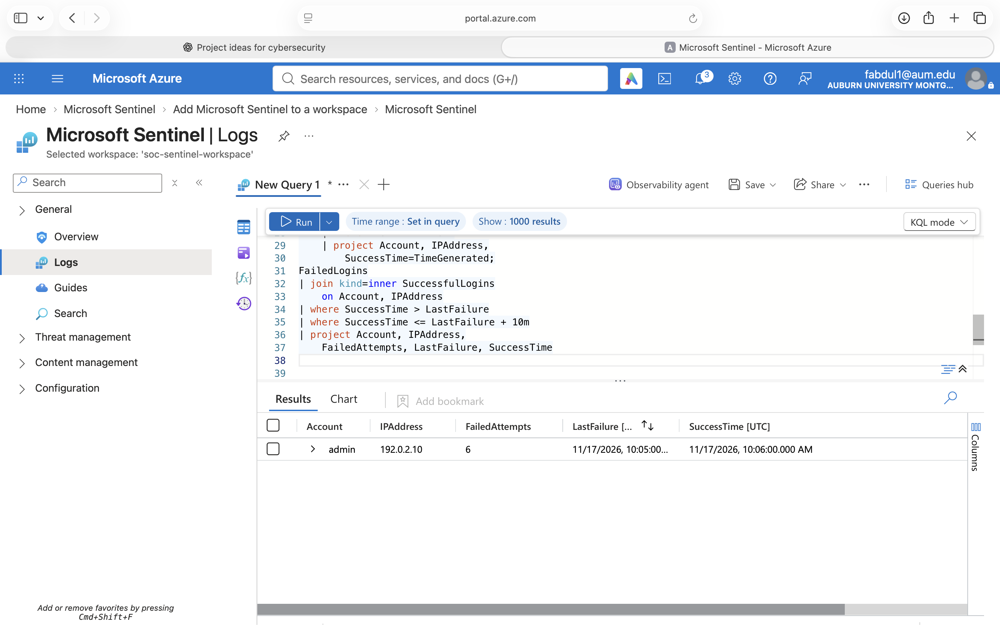

## Project Overview
This cybersecurity portfolio project demonstrates brute-force detection and authentication event correlation using Microsoft Sentinel and Kusto Query Language (KQL) with simulated Windows security events.

## Tools Used
- Microsoft Sentinel
- Azure Log Analytics
- Kusto Query Language (KQL)
- Windows Event IDs 4625 and 4624 (simulated)

## Investigation Scenario
Six failed login attempts targeted the `admin` account from IP address `192.0.2.10`, followed by a successful login one minute after the final failure.

## Detection Results
- Account: `admin`
- Source IP: `192.0.2.10` (test/documentation IP)
- Failed attempts: 6
- First failed login: 10:00 UTC
- Last failed login: 10:05 UTC
- Successful login: 10:06 UTC

## Investigation Steps
1. Created synthetic authentication events using KQL `datatable`.
2. Detected repeated failed logins using Event ID 4625.
3. Investigated authentication timestamps.
4. Correlated a subsequent successful login using Event ID 4624 and KQL `join`.
5. Documented the findings in a SOC incident report.

## Incident Investigation Report
The incident investigation report is included as a PDF in this repository.

## Skills Demonstrated
- SIEM investigation
- KQL querying
- Brute-force pattern detection
- Authentication event correlation
- Incident reporting

## Disclaimer
All authentication events in this project are simulated. No real security compromise was detected.

## Author
Fhariyazunnisa Abdul
## Microsoft Sentinel Investigation Screenshots

### 1. First KQL Query

### 2. Brute-Force Detection

### 3. Login Investigation

### 4. Successful Login Correlation

## KQL Detection Queries
- [Brute-Force Detection](KQL-Queries/Brute-Force-Detection.kql)
- [Successful Login Correlation](KQL-Queries/Successful-Login-Correlation.kql)
